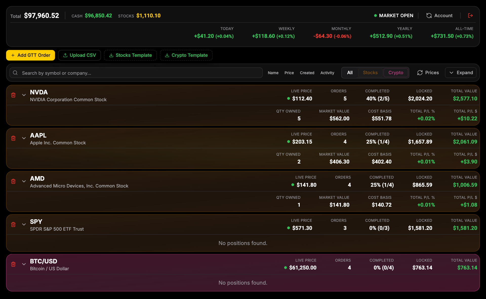
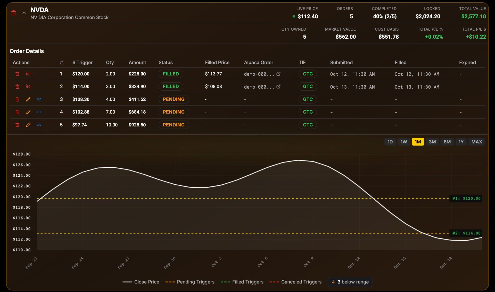

<div align="center">

<h1>Alpaca GTT Order Tracker</h1>

<p><b>Laddered buy-the-dip orders for Alpaca.</b></p>

<p><i>Alpaca has no good-til-triggered orders. This watches the price and places each rung of the ladder when it is hit.</i></p>

<h6>


</h6>

<a href="#how-it-works"><b>How it works</b></a> ·
<a href="#features"><b>Features</b></a> ·
<a href="#run-it"><b>Run it</b></a> ·
<a href="#reference"><b>Reference</b></a>

<br><br>



<sub>The real frontend, run against a local mock of the backend serving demo paper-account data.</sub>

</div>

<br>

## The problem

A common way to buy into a falling stock is a ladder: buy a little at one price, more a few
percent lower, more again below that, each placed only when the price gets there. Alpaca has
no good-til-triggered (GTT) orders, and parking a stack of limit orders ties up buying power
and needs re-entering every day for `day` orders. This app keeps the ladder on your own server
and only sends Alpaca an order when its trigger price is reached.

## How it works

<table>
<tr>
<td width="33%" valign="top">

**1 · Define a ladder**

Symbol, first trigger price and quantity, a quantity multiplier (say 1.5x) and a price
multiplier (say 0.95x), and up to 20 rungs. Or upload many at once from a CSV template.

</td>
<td width="33%" valign="top">

**2 · Watch the price**

A FastAPI background task checks pending rungs against the latest Alpaca price every 60
seconds. The browser gets live prices over Alpaca's WebSocket and order changes over SSE.

</td>
<td width="33%" valign="top">

**3 · Place the order**

When the price falls to a rung's trigger, the backend sends Alpaca a limit buy for that
rung, then tracks it through to filled, cancelled or expired.

</td>
</tr>
</table>

## One ladder, opened up

<div align="center">



<sub>Same demo data. Each rung's trigger is drawn on the price chart; the badge counts rungs below the visible range.</sub>

</div>

Every rung can be edited, deleted, or linked by hand to an order you already placed on Alpaca,
so existing orders can be brought under the tracker.

## Features

- **Paper or live with one flag.** `USE_PAPER_TRADING` picks the keys, and paper and live each get their own SQLite database.
- **Fractional and crypto.** Fractional stock quantities use `day` orders, whole shares can use `gtc`, and crypto pairs like `BTC/USD` always use `gtc`.
- **Safety halt.** A rung is skipped if the price is more than 20% (stocks) or 50% (crypto) below its trigger, which usually means bad data or the wrong symbol.
- **Corporate actions.** Splits, mergers and delistings expire the rest of a ladder instead of buying at a stale price.
- **CSV bulk upload.** Stock and crypto templates, with warnings for rounding and duplicate triggers before anything is created.
- **Account at a glance.** Cash, positions, and P/L for today, week, month, year and all time, plus per-symbol cost basis.
- **WhatsApp alerts.** Optional fill, failure, cancel and expiry messages, and a daily summary at market close, sent through a self-hosted [WAHA](https://waha.devlike.pro) instance.
- **Password-gated UI.** A single `UI_PASSWORD` guards the web app. The API itself has no auth, so keep the backend private.

## Run it

Needs Python 3.11+, Node with pnpm, and an Alpaca account (paper keys are free).

```bash
git clone https://github.com/parthchandak02/alpaca-gtt-trading.git
cd alpaca-gtt-trading
cp .env.example .env                 # add Alpaca paper keys and a UI password
python3 -m venv backend/.venv && backend/.venv/bin/pip install -r backend/requirements.txt
./scripts/10-run-all.sh              # backend :8000, frontend :3000
```

The frontend's API URL is hard-coded in `frontend/app/layout.tsx` and `frontend/services/api.ts`
to the author's Cloudflare Tunnel hostname; point it at `http://localhost:8000` (or your own
host) before running.

## Reference

<details>
<summary><b>Configuration (<code>.env</code>)</b></summary>

```bash
# ========== TRADING MODE ==========
USE_PAPER_TRADING=true  # false for live trading

# ========== ALPACA API - PAPER ==========
ALPACA_PAPER_API_KEY=your_paper_key
ALPACA_PAPER_SECRET_KEY=your_paper_secret

# ========== ALPACA API - LIVE ==========
ALPACA_LIVE_API_KEY=your_live_key
ALPACA_LIVE_SECRET_KEY=your_live_secret

# ========== AUTHENTICATION ==========
UI_PASSWORD=your_ui_password
JWT_SECRET_KEY=your_jwt_secret  # Generate with: openssl rand -hex 32

# ========== SERVER ==========
HOST=0.0.0.0
PORT=8000
CORS_ORIGINS=http://localhost:3000,https://your-domain.com
NEXT_PUBLIC_API_URL=http://localhost:8000

# ========== OPTIONAL: WHATSAPP ==========
WHATSAPP_ENABLED=false
WHATSAPP_PHONE_NUMBER=14155551234  # Digits only, no +
WHATSAPP_GROUP_ID=123456789@g.us   # Optional: send to group
WAHA_API_URL=http://localhost:3001
WAHA_API_KEY=your_waha_key
WAHA_SESSION_NAME=default

# ========== OPTIONAL: CLOUDFLARE ==========
CLOUDFLARE_API_TOKEN=your_token
CLOUDFLARE_ACCOUNT_ID=your_account_id

# ========== OPTIONAL: DEBUG ==========
LOG_LEVEL=INFO
DEBUG=false
```

</details>

<details>
<summary><b>Scripts</b></summary>

All scripts are in `scripts/`, numbered by category.

**Development (1x)**

| Script | Description |
|--------|-------------|
| `10-run-all.sh` | Start backend + frontend together |
| `11-run-backend.sh` | Start backend only |
| `12-run-frontend.sh` | Start frontend only |

**Deployment (2x)**

| Script | Description |
|--------|-------------|
| `20-deploy-frontend.sh` | Deploy frontend to Cloudflare Pages |
| `21-setup-tunnel.sh` | Set up Cloudflare Tunnel configuration |
| `22-start-tunnel.sh` | Start Cloudflare Tunnel |
| `23-check-config.sh` | Verify Cloudflare configuration |
| `24-deploy.sh` | Git push + Cloudflare Pages deploy |

**Maintenance (3x)**

| Script | Description |
|--------|-------------|
| `30-cleanup-restart.sh` | Full cleanup and restart services |
| `31-fix-db-permissions.sh` | Fix database file permissions |
| `32-fix-code-quality.sh` | Auto-fix linting issues (Ruff) |
| `33-check-code-quality.sh` | Check code quality without fixing |
| `34-generate-version.sh` | Generate version.json for deployments |
| `35-complete-setup.sh` | Production setup checklist |
| `36-reset-paper-db.sh` | Reset paper trading database |
| `37-verify-gtt-readiness.sh` | Pre-market readiness check |
| `38-reactivate-expired-orders.py` | Reactivate incorrectly expired orders |
| `39-check-expired-orders.py` | Check for expired orders in DB |

**Testing (4x)**

| Script | Description |
|--------|-------------|
| `40-test-e2e-flow.py` | End-to-end order flow test |
| `41-test-price-cache.py` | Price cache service test |
| `42-test-gtt-order-status.py` | GTT order status test |
| `43-test-alpaca-websocket.py` | Alpaca WebSocket test |
| `44-test-verify-gtt-triggers.py` | Verify GTT trigger logic |
| `45-test-portfolio-history.py` | Portfolio history test |
| `46-check-missed-triggers.py` | Check for missed triggers |
| `47-analyze-gtt-orders.py` | Order analysis (safety, balance) |
| `48-check-backend-health.py` | Backend API health check |
| `49-run-tests.sh` | Run automated test suite |

**WhatsApp (5x)**

| Script | Description |
|--------|-------------|
| `50-setup-waha.sh` | Set up WAHA Docker container |
| `51-setup-waha-session.sh` | Set up WhatsApp session |
| `52-get-waha-qr.sh` | Get QR code for WhatsApp linking |
| `53-search-waha-groups.py` | Search WhatsApp groups |
| `54-test-whatsapp.py` | Test WhatsApp notifications |
| `55-trigger-daily-summary.py` | Manually trigger daily summary |
| `56-monitor-waha-session.sh` | Monitor the WAHA session |

</details>

<details>
<summary><b>WhatsApp notifications</b></summary>

```bash
# 1. Start WAHA (Docker)
./scripts/50-setup-waha.sh

# 2. Add to .env (API key shown in script output)
WHATSAPP_ENABLED=true
WHATSAPP_PHONE_NUMBER=14155551234
WHATSAPP_GROUP_ID=123456789@g.us  # Optional: group notifications
WAHA_API_URL=http://localhost:3001
WAHA_API_KEY=your_key_here

# 3. Set up the session (scan the QR code with WhatsApp)
./scripts/51-setup-waha-session.sh

# 4. Test a notification
backend/.venv/bin/python scripts/54-test-whatsapp.py

# 5. Manual daily summary (--dry-run to preview)
backend/.venv/bin/python scripts/55-trigger-daily-summary.py --dry-run
```

Messages are sent for `ORDER_FILLED`, `ORDER_FAILED`, `ORDER_CANCELLED` and
`CORPORATE_ACTION_EXPIRED`, plus a daily summary at market close (P/L, fills, pending orders).

</details>

<details>
<summary><b>Order rules</b></summary>

| Requirement | Value | Notes |
|-------------|-------|-------|
| Min order value | $1.00 | quantity x price >= $1 |
| Min quantity | 0.01 | Fractional orders |
| Safety drop (crypto) | 50% | Allows volatile market drops |
| Safety drop (stocks) | 20% | Protects against bad data or symbol mismatch |
| Rungs per ladder | 1-20 | `iterations` |

Corporate actions (splits, mergers, delistings) expire all remaining rungs of a ladder.
Expired rungs show a red `EXPIRED` badge in the UI.

</details>

<details>
<summary><b>Real-time channels</b></summary>

| Channel | Purpose | Technology |
|---------|---------|------------|
| Price stream | Live price updates | Alpaca WebSocket, HTTP polling fallback |
| Order events | Status changes, fills | Server-Sent Events (SSE) |
| Heartbeat | Keep connections alive | 15 s interval (Cloudflare timeout) |

</details>

<details>
<summary><b>Production and troubleshooting</b></summary>

The author's setup runs both servers under pm2, the frontend on Cloudflare Pages and the
backend behind a Cloudflare Tunnel. Copy `ecosystem.config.example.js` and
`cloudflared-config.example.yml` to their non-example names first.

```bash
pm2 start ecosystem.config.js        # backend + frontend
./scripts/20-deploy-frontend.sh      # frontend to Cloudflare Pages
./scripts/23-check-config.sh         # verify Cloudflare settings

./scripts/30-cleanup-restart.sh      # full reset
./scripts/31-fix-db-permissions.sh   # database permissions
pm2 restart alpaca-backend           # restart the backend
docker logs waha                     # WAHA logs
backend/.venv/bin/python scripts/48-check-backend-health.py
./scripts/37-verify-gtt-readiness.sh # pre-market readiness

./scripts/33-check-code-quality.sh   # Ruff + Vulture
./scripts/32-fix-code-quality.sh     # auto-fix
```

</details>

<details>
<summary><b>Project layout</b></summary>

```
backend/                 FastAPI app (main.py), SQLAlchemy models, Alpaca client
  gtt_service.py         Ladder creation, trigger checks, safety halt, corporate actions
  core/                  Background price loop, price cache, SSE, WebSocket, daily summary, WhatsApp
  routers/               GTT orders, account, prices, assets, CSV, historical bars, auth, events
  migrations/            One-off schema migrations
frontend/                Next.js + React + Tailwind UI
  components/            Order cards, add-order and CSV modals, price chart, account summary
  hooks/                 Live prices, SSE updates, order grouping, filtering and actions
alpaca-trader-backup/    An older copy of the frontend
scripts/                 Run, deploy, maintenance, test and WhatsApp scripts (see above)
templates/               CSV templates for bulk upload
```

</details>

<br>

<div align="center">
<sub>Built with FastAPI, SQLAlchemy, Next.js, Chart.js and alpaca-py. Not affiliated with Alpaca.</sub>
</div>
